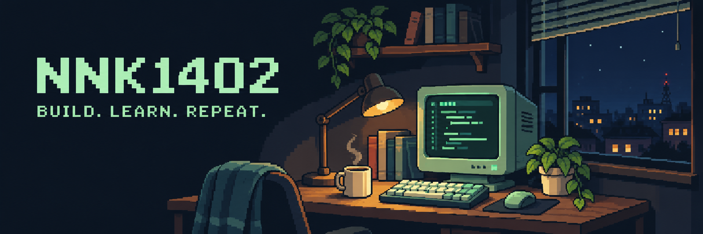
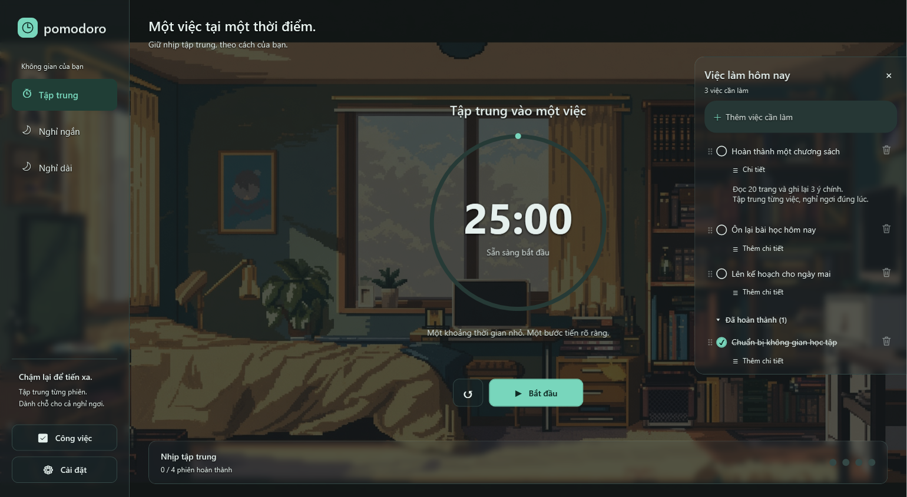

  

  <a href="#dự-án-nổi-bật">Dự án nổi bật</a> ·
  <a href="#công-nghệ-mình-đang-dùng">Công nghệ</a> ·
  <a href="https://github.com/nnk1402?tab=repositories">Tất cả repository</a>

## Một chút về mình

- Học tại Đại học FPT
- Biết edit video

## Dự án nổi bật

### 🍃 [Pomodoro](https://github.com/nnk1402/Pomodoro-timer)

Một không gian để tập trung từng việc, nghỉ ngơi đúng lúc.

`C#` `WPF` `.NET 10` `Windows`

Ba chế độ tập trung/nghỉ ngắn/nghỉ dài, theme sáng/tối, nền ảnh hoặc video, ghi chú cho task và kéo thả sắp xếp. Có phím tắt toàn màn hình và lưu cài đặt qua các lần mở ứng dụng.

### Những dự án khác

| Dự án | Nội dung | Công nghệ |
| :--- | :--- | :--- |
| [Spider-Man Play Time Management](https://github.com/nnk1402/Spider-man-play-time-management) | Quản lý thời gian chơi Spider-Man. | C# |
| [Homestay Booking Management](https://github.com/nnk1402/HomestayBookingManagement) | Dự án quản lý đặt phòng homestay. | Java |
| [Traditional Feast Order](https://github.com/nnk1402/TraditionalFeastOrderbyNNK) | Dự án quản lý đặt tiệc. | Java |
| [Betting Game](https://github.com/nnk1402/Betting-Game) | Một trong những dự án đầu tiên khi học Java. | Java |

## Công nghệ mình đang dùng

| Ứng dụng desktop | Lập trình | Công cụ |
| :--- | :--- | :--- |
| WPF · .NET · XAML | C# · Java | Git · GitHub · Visual Studio |

 

  <b>Chậm lại để tiến xa.</b> 
  Một việc mỗi lúc. Một dòng code tốt hơn mỗi ngày.

